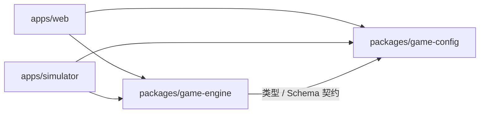

# Monorepo 技术架构

> 文档版次：0.1.0-docs.1 · 2026-11-25 · Phase 0 文档交付；游戏尚未实现。
> 来源：[输入基准](../reference/SOURCE-BASELINE.md)；对应章节 / 说明：10.1、10.5。
> 效力：仅 PRD 明列项为用户已确认；其余沿用设计基准。本文新增接口细化、测试设计、任务拆分属于交付建议；所有初始数值待模拟与试玩验证。
> 待决议建议没有生效；受影响规则落地前须关闭对应 [D 项](../development/OPEN-DECISIONS.md)（验证型门按登记说明执行）。

## 技术栈与目标目录

pnpm Workspace + Catalog；TypeScript strict；Vue 3、Vite、Pinia、Vue Router、Tailwind CSS + CSS Variables、CSS/WAAPI；Zod 校验存档和外部配置；Node.js + tsx CLI；Vitest、Playwright、ESLint、Prettier、GitHub Actions。依赖版本在 Phase 1 核实与锁定；暂不引入 Turborepo/Nx。包名 @infinite/* 为建议。

```text
2048-infinite/
├── apps/
│   ├── web/src/
│   │   ├── components/{board,skills,boss,common}/
│   │   ├── composables/ stores/ router/ views/
│   │   └── animations/ storage/ styles/
│   └── simulator/src/
│       ├── agents/ evaluation/ experiments/ metrics/
│       └── runner.ts  cli.ts
├── packages/
│   ├── game-engine/src/
│   │   ├── board/ energy/ skills/ modifiers/ levels/
│   │   ├── boss/ events/ random/ history/ replay/ state/
│   │   └── index.ts
│   ├── game-config/src/
│   │   ├── schemas/ skills.ts protocols.ts levels.ts
│   │   └── boss.ts balance.ts index.ts
│   ├── eslint-config/
│   └── tsconfig/
├── tests/{e2e,fixtures}/
├── docs/{product,game-design,architecture,development,adr}/
├── .github/{workflows,ISSUE_TEMPLATE}/
├── .github/pull_request_template.md
├── AGENTS.md README.md
└── pnpm-workspace.yaml pnpm-lock.yaml package.json
```

按里程碑逐步建立目录，不预先创建全部空壳。web 与 simulator 均依赖 game-engine 与 game-config；game-engine 依赖 game-config 的类型/Schema，但通过注入配置运行，不绑定默认数值；game-config 不依赖引擎。禁止 Web 与 simulator 相互依赖、循环依赖、跨包深层导入。通过 exports、ESLint 与 CI 约束，workspace:* 链接内部包。

## Web 与模拟器集成

Pinia useGameStore 以 shallowRef 持有不可变 GameState，接受成功 Action 后替换根对象、记录日志并保存；useUIStore 管理暂停、弹窗、目标选择、输入锁；useSettingsStore 管理显示/音效/动画；useReplayStore 使用独立状态。UI 不重复实现合法性、分数、生成、技能或 Boss 规则。同步逻辑与异步动画分离。

模拟器通过同一引擎和可注入配置运行，Bot 只得到 ObservableGameState（隐藏真实 RNG state、未来种子结果以及可能泄漏它们的快照）及合法操作；使用独立策略 RNG，不干扰游戏随机流。Node 脚本可直接运行，无需 DOM、Vue 或真实时间。

## 模块依赖与职责



game-config 只承载配置、类型和 Schema，不承载规则执行；game-engine 通过调用参数接收具体配置，不能偷偷读默认配置或浏览器存储。Schema 放置不得形成 config→engine 的反向依赖。公共 API 经 exports 暴露，不通过内部文件路径绕过。

Vue 实施建议：Composition API、`<script setup lang="ts">`；Pinia 持有 shallowRef 根状态，计算展示使用派生数据；规则状态由 dispatch 替换，UI 不深度代理后再写入。该实现风格是工程建议，不改变已确认产品决策。

平台能力分离：本地存储/导入导出在 web adapter；文件报告/超时保护在 simulator；任何真实时间只用于展示、运维或耗时统计，不进入引擎规则分支。回放记录器是外层纯编排能力，存储写入是适配层能力。

详见 [状态模型](STATE.md)、[引擎契约](ENGINE.md)、[存档回放](SAVE-REPLAY.md)、[模拟](SIMULATION.md)。当前没有安装依赖、初始化 Workspace 或执行构建；命令、路径是未来目标结构。
